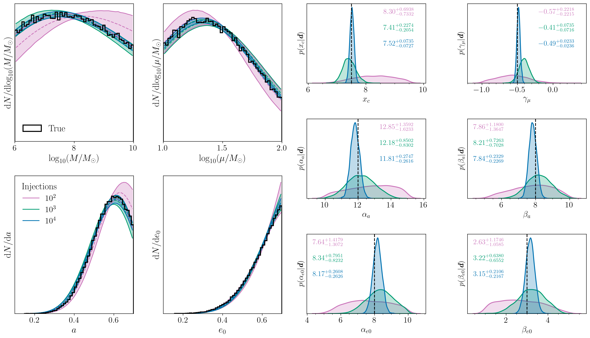

# MBH population from EMRIs

Hierarchical inference of the EMRI population with LISA. Mock catalogues of detected extreme mass-ratio inspirals (EMRIs) are generated for two parametrised population models, A and B, with 10², 10³ and 10⁴ injected events. The population hyperparameters are then recovered, including the effect of the LISA selection function. The analysis is described in [arXiv:2508.16399](https://arxiv.org/abs/2508.16399).

- [`scripts/`](./scripts): catalogue generation and inference code.
- [`PLOTS/`](./PLOTS): posterior and posterior-predictive figures.
- [`CITATION.bib`](./CITATION.bib): references.

## Highlighted result

Population A: the recovered MBH-mass and compact-object-mass distributions (top left), the spin and plunge-eccentricity distributions (bottom left) and the hyperparameter posteriors (right), for 10² (pink), 10³ (green) and 10⁴ (blue) detected EMRIs. Black marks the injected truth. The posteriors tighten around the truth as the catalogue grows.

The remaining figures in [`PLOTS/`](./PLOTS) show Population B and the cases where the population used for inference differs from the one that generated the data (`MIX_*` and `PPD_A_B_DIFF_POP_*`).

## Citation

If you use any part of this work please cite it. The references are collected in [`CITATION.bib`](./CITATION.bib).

## Data availability

The posterior samples are available at 
