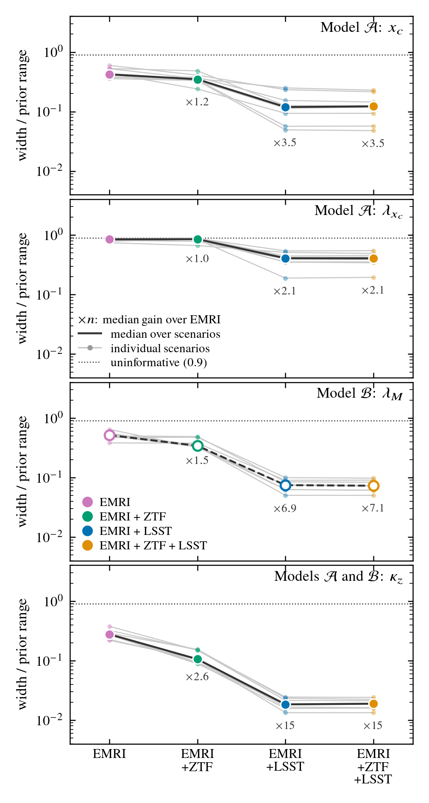
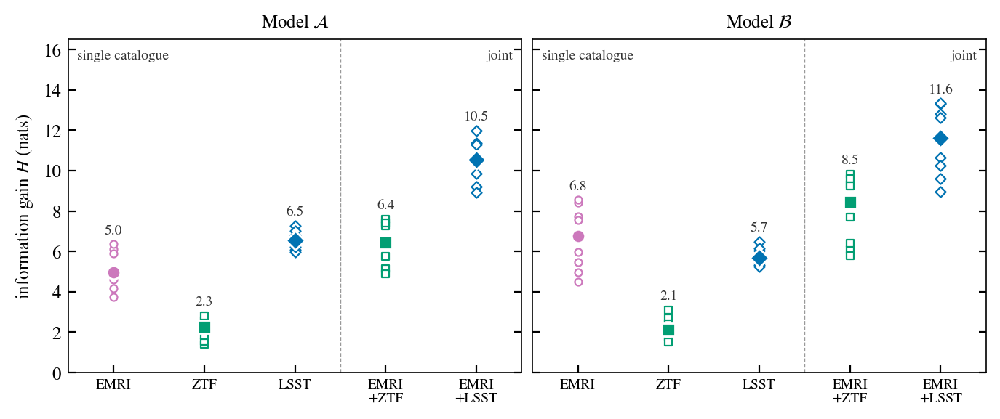
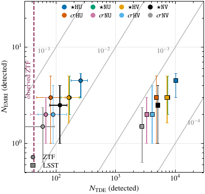
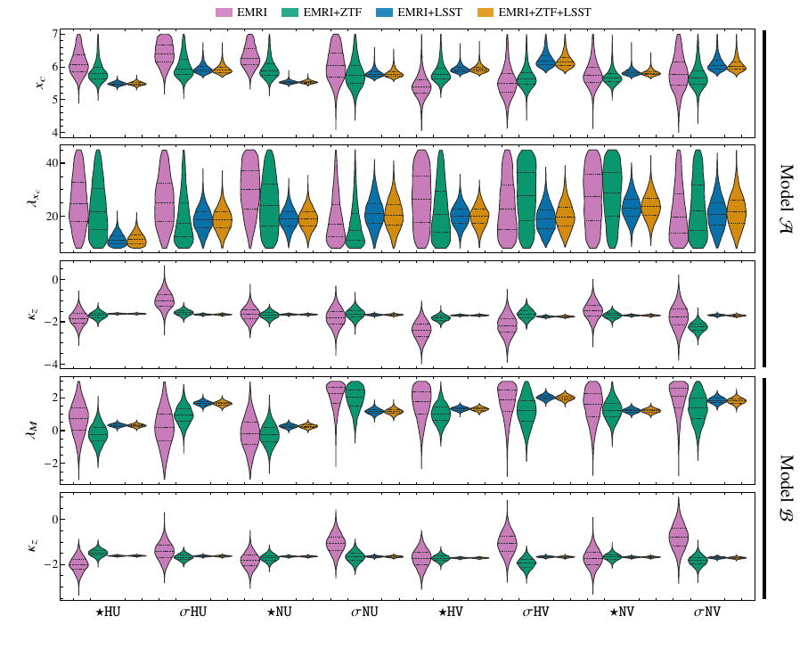

# MBH population from EMRIs and TDEs

Joint inference of the MBH population from EMRIs detected by LISA and tidal disruption events (TDEs) detected by ZTF and LSST. Mock universes are built from galaxy mass functions, nuclear star cluster evolution and merger-rate models for eight population scenarios (MBH mass relation × nucleation fraction × occupation fraction). Detectability of every event is emulated with neural networks, a Fisher analysis gives the per-event posteriors, and a hierarchical Bayesian analysis infers two parametrised population models (A and B) from EMRIs only, TDEs only, and both.

## Layout

| Folder | Content |
| --- | --- |
| [`astrophysical_setup/`](./astrophysical_setup) | Cosmology, galaxy and NSC models, relaxation, EMRI and TDE rates |
| [`data_generation/`](./data_generation) | Mock universes, event parameters, LISA SNR and TDE detection, survey footprints |
| [`data_gen_realistic/`](./data_gen_realistic) | Realistic detection counts and thinning sweeps for the universe selection |
| [`training_EMRI_SNR/`](./training_EMRI_SNR), [`training_TDE_detectability/`](./training_TDE_detectability) | Training of the SNR and detection-probability emulators |
| [`fisher_analysis/`](./fisher_analysis) | Fisher posteriors of each detected EMRI and TDE |
| [`selection_function/`](./selection_function) | Neural-network selection function used in the likelihood |
| [`hierarchical_inference/`](./hierarchical_inference) | Population inference, run scripts and plotting |
| [`hierarchical_inference_altered/`](./hierarchical_inference_altered) | Variants of the inference |
| [`plots/`](./plots) | Diagnostic and paper plotting scripts |
| [`tests/`](./tests) | Validation of rates, time averaging and selection-function bias |
| [`EXECUTABLES/`](./EXECUTABLES), `SUBMIT_FILES/` | Shell and HTCondor wrappers for the pipeline |

## Highlighted results

**Adding TDEs sharpens the MBH mass and redshift constraints.** The 90% posterior width of the shared hyperparameters, relative to the hyperprior range, for EMRIs alone and with ZTF and/or LSST TDEs added. Grey lines are the eight scenarios and the black line their median, annotated with the median gain over EMRIs only. LSST brings gains of about 5–15 in the mass and redshift parameters.

**Information gained.** The information gain from hyperprior to hyperposterior for each catalogue combination, for both models.

**Detected counts.** Detected EMRIs against detected TDEs for the eight scenarios. LSST detects thousands of TDEs per few EMRIs, while ZTF detects tens to hundreds.

**Hyperparameter posteriors** for every scenario and catalogue combination.

